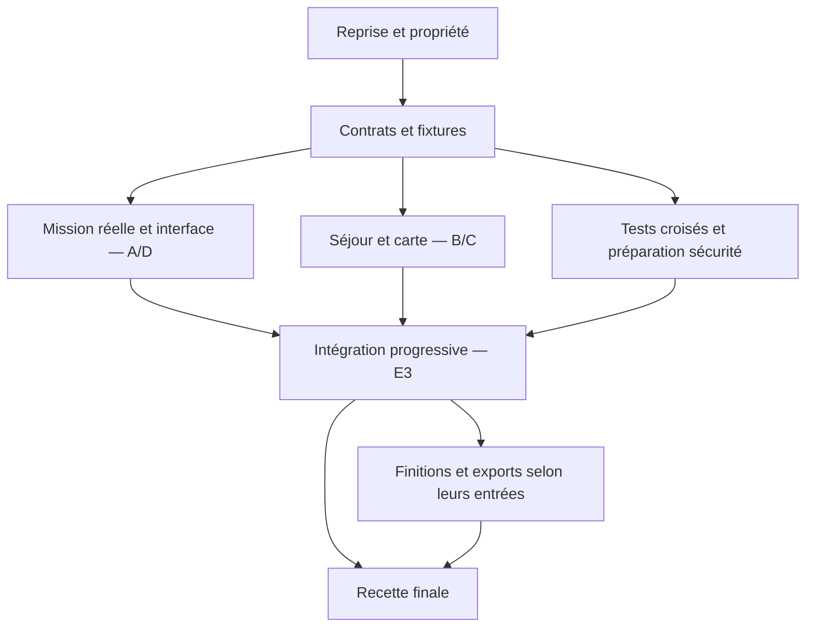

# Plan de développement RunAI — équipes d’agents

> Proposition du 7 novembre 2026, préparée pour Iba et Mathieu. Ce document décrit le développement à lancer ; il ne constate pas une recette réussie et ne lance aucun nouvel agent. La [spécification frontend](FRONTEND.md) fait partie du plan.

## 1. Cap produit et périmètre

Construire le compagnon du séjour complet, pas trois agents de réservation et un survol isolé : demande texte ou voix, informations manquantes, recherches et préparatifs en parallèle, vraies questions humaines, budget, timeline, carte et récap.

**Vision 3D : maison → gare/aéroport → train ou vol → hôtel → dossard → départ et course → retour.** Les liaisons illustratives sont distinguées des itinéraires sourcés. Aucun paiement, consentement, déclaration de santé, création de compte ou envoi automatique.

| Priorité | Livrable |
| --- | --- |
| P0 | Mission réelle sûre, vraie question humaine, budget honnête, séjour cohérent et complet sur carte/timeline, chapitres, application mobile/clavier et aperçu privé. |
| P1 | Finition 3D, repli 2D, voix ciblée, intégration coach, PDF/.ics et retour détaillé. Réutiliser les modules déjà livrés. |
| P2 | Boucle Devin échec → correctif → revue → nouveau test, nouvelles plateformes et démo enrichie ; jamais avant stabilisation du cœur. |

Conserver Python/FastAPI, Pydantic, les Protocols, le SSE, le frontend léger et MapLibre. Milan reste le scénario de continuité de la V1, sous réserve d’édition, ouverture et conditions revérifiées. Questions humaines par texte/boutons ; voix utile sans être obligatoire partout.

## 2. État de départ : réutilisation avant fan-out

| État observé | Briques | Conséquence |
| --- | --- | --- |
| Fusionné et observé | Socle, SDK H, recherche Linkup, voix, app démo, survol GPX/KML | PR #23 à #28. Le branchement complet réel n’est pas sur main observé. |
| En cours déclaré | V1 réelle, ask_user, questions texte/boutons, refonte frontend | Session V1 active ; code local non vérifié dans cette session. |
| PR ouvertes observées | Devis, récap PDF/.ics, coach, paquet de skills | #30, #31, #32 et #29 ; API inspectées, pas de validation fonctionnelle ici. |
| PR logistique observée | Règlement, éligibilité, timeline et .ics | #33 : réutiliser build_timeline et ses modèles ; ne pas créer une seconde timeline métier. |

Références : [V1 active](https://app.devin.ai/sessions/047fc25509fc47eaa23c543192c3481e), [devis #30](https://github.com/IbaDemesy/RunAI/pull/30), [récap #31](https://github.com/IbaDemesy/RunAI/pull/31), [coach #32](https://github.com/IbaDemesy/RunAI/pull/32), [logistique #33](https://github.com/IbaDemesy/RunAI/pull/33), [skills #29](https://github.com/IbaDemesy/RunAI/pull/29). Statuts à revérifier en G0 ; aucune PR ouverte n’est considérée fusionnée.

## 3. Organisation : 1 chef, 5 sous-chefs, 15 spécialistes

**21 rôles ne signifie pas 21 nouvelles sessions simultanées.** Réutiliser les auteurs et sessions actifs ; un rôle déjà rempli ne déclenche pas un doublon.

| Équipe | Sous-chef | Responsabilité | Spécialistes |
| --- | --- | --- | --- |
| A — Socle et agents réels | Chef backend | Mission réelle fiable, questions humaines, contrôle des sessions. | A1, A2, A3 |
| B — Intelligence du séjour | Chef données et logistique | Week-end cohérent, sourcé et chiffré, en réutilisant devis, coach et récap. | B1, B2, B3 |
| C — Voyage 3D complet | Chef cartographie et 3D | Étendre le survol existant à toute l’expérience, de chez soi au retour. | C1, C2, C3 |
| D — Application et voix | Chef expérience produit | Unifier demande, suivi des agents, questions, séjour et carte dans une belle interface. | D1, D2, D3 |
| E — Qualité et livraison | Chef QA et intégration | Prouver le résultat, intégrer sans collisions et livrer une démo reproductible. | E1, E2, E3 |

Le chef général fixe produit, contrats et priorités. Les sous-chefs décomposent leurs trois lots, traitent les blocages métier et revoient les sorties. Les spécialistes produisent code et preuves. E3 intègre ; l’humain décide des fusions et engagements.

### Mise en œuvre dans Devin

- Un **dynamic workflow racine** représente les dépendances et transmet les sorties structurées entre cadrage, implémentation, revue et intégration. Les sous-chefs valident les lots et reçoivent leurs résultats, pas seulement un statut « fini ».
- Le workflow central crée les spécialistes à partir du manifeste validé par les sous-chefs. Pas de création récursive illimitée de sessions enfants ; toute délégation hors manifeste est interdite.
- VM séparée et branche Git par auteur. Aucune VM partagée prévue ; les fichiers locaux des autres sessions ne sont pas accessibles sans passage par Git.
- Départ proposé : 1 chef + 1 sous-chef actif + 5 auteurs + 1 reviewer = **8 sessions actives**. Extension possible à 1 chef + 2 sous-chefs + 6 auteurs + 1 reviewer = **10**, si capacités et budget le permettent. Ce sont des plafonds proposés, pas des quotas garantis.
- Activer les sous-chefs aux jalons et revues plutôt que les laisser tourner en attente. Les 15 spécialistes sont des responsabilités, éventuellement reprises par leurs sessions existantes.
- Distinguer la flotte **Devin de développement** et les **agents H du produit**, soumis à leurs propres quotas et conditions des fournisseurs.

## 4. Exécution : dépendances minimales et intégration continue



Vue simplifiée : P1 démarre dès que ses propres entrées sont prêtes, pas après tous les P0. E3 intègre chaque incrément prêt ; seule la recette finale impose une barrière globale.

### G0 — Reprise et propriété

**Responsable :** Chef général et propriétaires actuels

- Inventorier main, PR et travaux V1 non poussés ; obtenir un commit de référence sans interrompre l’autre session.
- Attribuer chaque périmètre à un auteur et accepter les lots déjà livrés ; confirmer la logistique de Mathieu.
- Vérifier scénario de démo, conditions des sites, capacités Devin, quotas et budget.

**Critère de sortie :** Manifeste versionné : base_sha, lots, owners, périmètres, dépendances, critères et budgets. Aucun doublon.

### G1 — Contrats et découplage

**Responsable :** Sous-chef A et E3 ; avis B/C/D

- Définir JourneyPlan, questions humaines et événements versionnés sans casser Race/StepResult.
- Livrer fixtures train/avion/incomplet et points d’extension additifs.
- Préparer les rares extractions nécessaires pour éviter les écritures concurrentes dans runner.py ou le shell.

**Critère de sortie :** Petite PR de contrats, base immuable et interfaces utilisables sans fournisseur.

### Vague 1 — Implémentations parallèles

**Responsable :** Sous-chefs activés au besoin

- Ordonnancer A1–A3, B1–B2, C1–C2, D1 et E1 selon capacité ; E2 prépare les tests de sécurité.
- Développer sur fixtures si données réelles absentes ; ne pas bloquer la carte sur H.
- Revoir chaque lot dès sa livraison sans attendre toute une équipe.

**Critère de sortie :** Incréments testés et relus ; première chaîne demande → question → résultat avant les raffinements.

### Vague 2 — Intégration progressive

**Responsable :** E3 et sous-chef du lot

- Brancher A+D pour mission/questions ; B+C pour séjour/carte ; unir ces chaînes via les mêmes contrats.
- Démarrer B3/C3/D2/D3 dès leurs entrées disponibles, pas après une barrière globale.
- E3 câble les points partagés. Les spécialistes livrent leurs modules sans collisions.

**Critère de sortie :** Une seule app relie agents, questions, budget, timeline, 3D et récap ; aucun module orphelin.

### Vague 3 — Recette et livraison

**Responsable :** Chef E ; décisions finales humaines

- Exécuter tests shell et CI ; corriger les P0 ; recette UI via l’agent de test après accord.
- Faire un run réel autorisé et un replay déterministe. Nommer toute étape non vérifiée.
- Livrer un browser_preview privé ouvrable ici, une démo courte et ses sous-titres. Publication et fusion restent séparées.

**Critère de sortie :** Recette satisfaite ou limites explicites. Aucun résultat replay présenté comme live.

### Règles du workflow

- Le manifeste est une sortie enregistrée G0/G1 : base_sha, lot_id, owner, périmètre, dépendances, priorité, critères et budgets. Le fan-out en dérive de façon reproductible.
- Pipeline par lot : auteur → revue du sous-chef → correctif éventuel → E3. Ne pas attendre toute une équipe pour revoir son premier lot prêt.
- Chaque auteur pousse sa branche et renvoie head_sha. E3 consomme ces sorties structurées ; pas de réécriture d’historique ni auto-fusion de main.
- P0 bloqué : pas de livraison ; correction par le propriétaire. P1 incomplet : manque visible et arbitrage de périmètre. Maximum deux cycles sans progrès avant retour au chef.
- Préparation, revue et intégration appartiennent au workflow enregistré. Reprise des résultats terminés seulement si leurs prompts et hypothèses restent valides ; réévaluer si base, contrat ou état externe change.
- Notifications sur résultats et blocages, pas de polling bavard. Pour montrer un jalon immédiatement, faire terminer le lot à ce jalon.
- Budget global à confirmer avant lancement, budgets par lot et suivi ACU. Alerte douce à 30–45 min selon lot, pas arrêt dur. Micro-lots visés de 20–45 min, sans promesse de délai total ni de gain linéaire.

## 5. Les quinze lots

Les chemins ci-dessous sont des périmètres proposés à confirmer en G0/G1 d’après la V1. Les points partagés sont modifiés par un seul intégrateur. Chaque auteur écrit les tests unitaires de son module ; E1 vérifie les contrats croisés.

| Lot | Livrable | Priorité | Dépendances |
| --- | --- | --- | --- |
| A1 | Brancher les vrais services | P0 | G0, G1 |
| A2 | Questions et décisions humaines | P0 | G0, G1 ; D1 pour recette intégrée |
| A3 | Cycle de vie et quotas H | P0 | G0, G1 |
| B1 | Course, règles et budget sourcés | P0 | G0, G1 ; PR devis pour intégration |
| B2 | Itinéraire porte à porte | P0 | G1 ; fixtures immédiates, données B1/agents ensuite |
| B3 | Récap et calendrier cohérents | P1 | B2 et PR #31 |
| C1 | Carte multimodale du séjour | P0 | G1 ; fixtures avant B2 |
| C2 | Chapitres et caméra | P0 | G1 ; C1 pour recette intégrée |
| C3 | Lisibilité, 2D et performance | P1 | G1 ; C2 pour intégration |
| D1 | Parcours et direction visuelle | P0 | G0, G1 ; autres lots branchés progressivement |
| D2 | Voix et commandes ciblées | P1 | G1 ; C2, A3 et D1 pour branchement |
| D3 | Revue UX et accessibilité | P1 | D1 premier incrément puis candidat final |
| E1 | Contrats, fixtures et tests croisés | P0 | G1 ; parallèle aux implémentations |
| E2 | Sécurité et preuves réelles | P0 | G1 pour les cas ; A/D pour preuve réelle |
| E3 | Intégration, aperçu et démo | P0 | G0/G1 puis chaque lot prêt ; recette avant livraison |

### A1 — Brancher les vrais services (P0)

- **Périmètre :** Adaptateurs de runai/app/ et tests dédiés, après reprise de la V1.
- **Entrées :** G0/G1 et code de la V1 existante.
- **Sortie :** Branchement Linkup / H / Gladia ; modes demo, live et replay explicites.
- **Preuve de terminé :** Une mission live appelle les vrais services. Une clé absente produit une erreur utile, jamais un faux succès. Demo fonctionne sans clé.
- **Dépendances :** G0, G1
- **Réutilisation :** Compléter ou accepter le travail de la session V1 ; ne pas créer un deuxième auteur.

### A2 — Questions et décisions humaines (P0)

- **Périmètre :** runai/h/human_questions.py et tests dédiés ; extraire seulement si nécessaire.
- **Entrées :** HumanQuestion / HumanAnswer et ask_user de la V1.
- **Sortie :** Question corrélée à la bonne mission et session, attente, réponse texte/bouton, expiration et annulation.
- **Preuve de terminé :** Une vraie question H apparaît et la réponse revient au bon agent. Réponse périmée ou dupliquée rejetée. Santé, consentement, compte, envoi et paiement restent des arrêts humains.
- **Dépendances :** G0, G1 ; D1 pour recette intégrée
- **Réutilisation :** V1 et spike/portail_humain : pas de nouveau portail concurrent.

### A3 — Cycle de vie et quotas H (P0)

- **Périmètre :** runai/h/lifecycle.py et tests ; runner.py câblé par E3.
- **Entrées :** Pool multiclés et états H existants.
- **Sortie :** File bornée, pause, reprise, annulation, libération des slots et erreurs typées.
- **Preuve de terminé :** Tests de saturation, double annulation et timeout. Pas de slot local orphelin. Relire le quota ; idle ne signifie pas terminé. Aucun captcha contourné.
- **Dépendances :** G0, G1
- **Réutilisation :** Étendre le pool de runai/h/runner.py, ne pas le refaire.

### B1 — Course, règles et budget sourcés (P0)

- **Périmètre :** runai/planning/evidence.py et tests ; quote/ et coach/ restent à leurs auteurs.
- **Entrées :** Race, devis et résultats du coach disponibles.
- **Sortie :** Adaptation des données, provenance, vérification datée, inconnues et questions d’éligibilité.
- **Preuve de terminé :** Bonne édition et distance ; prix et options traçables. Poste absent = total partiel. Aucune validation médicale automatique ni règle généralisée à toutes les courses.
- **Dépendances :** G0, G1 ; PR devis pour intégration
- **Réutilisation :** PR #30 devis et #32 coach : intégrer leurs API, pas les réimplémenter.

### B2 — Itinéraire porte à porte (P0)

- **Périmètre :** runai/journey/planner.py et tests ; models.py réservé à G1/E3.
- **Entrées :** Origine consentie, course, hôtel, transport, horaires et préférences.
- **Sortie :** JourneyPlan : transferts locaux, train/vol, hôtel, dossard, départ, course et retour.
- **Preuve de terminé :** Fuseaux IANA et marges de correspondance ; alerte si arrivée tardive, dossard inaccessible ou hôtel trop éloigné. Choix incertains à confirmer.
- **Dépendances :** G1 ; fixtures immédiates, données B1/agents ensuite
- **Réutilisation :** La PR #33 fournit déjà build_timeline et ses modèles ; réutiliser son API après validation, sans seconde timeline métier.

### B3 — Récap et calendrier cohérents (P1)

- **Périmètre :** runai/planning/recap_adapter.py et tests ; aucun auteur concurrent dans recap/.
- **Entrées :** JourneyPlan, devis et API de récap.
- **Sortie :** Un même séjour pour timeline web, PDF et .ics ; adresse privée masquée.
- **Preuve de terminé :** Dates, fuseaux, montants et réserves identiques partout. Préparé ne veut pas dire réservé. Exports issus d’un instantané versionné.
- **Dépendances :** B2 et PR #31
- **Réutilisation :** recap_from_mission, render_pdf et render_ics existent dans la PR #31.

### C1 — Carte multimodale du séjour (P0)

- **Périmètre :** web/flyover/journey-data.js et tests JS dédiés.
- **Entrées :** JourneyPlan v1 et fixtures train, avion, incomplet.
- **Sortie :** Couches GeoJSON des étapes et segments, bornes géographiques par chapitre.
- **Preuve de terminé :** Géométrie sourcée si réelle, sinon liaison illustrative signalée. Vol, train, transfert et course distincts. Coordonnée manquante non inventée.
- **Dépendances :** G1 ; fixtures avant B2
- **Réutilisation :** Réutiliser route.js pour GPX/KML. Lisbonne est un exemple, pas un tracé officiel.

### C2 — Chapitres et caméra (P0)

- **Périmètre :** web/flyover/journey-player.js et tests ; flyover.js câblé par E3.
- **Entrées :** Contrat carte, mocks puis couches C1.
- **Sortie :** Vue globale, lecture/pause, saut à une étape et transitions continent/ville/course.
- **Preuve de terminé :** Le séjour entier est navigable ; le mode course garde seekKm, profil et survol existants. Pas de trajectoire stylisée présentée comme exacte.
- **Dépendances :** G1 ; C1 pour recette intégrée
- **Réutilisation :** Conserver RunAIFlyover ; ajouter une façade de voyage, pas un second moteur.

### C3 — Lisibilité, 2D et performance (P1)

- **Périmètre :** web/flyover/journey-fallback.js, journey.css et tests dédiés.
- **Entrées :** États C2 et budget de performance défini en G1.
- **Sortie :** Légende, repli 2D/timeline, reduced-motion et gestion d’erreurs de tuiles.
- **Preuve de terminé :** Carte indisponible sans blocage du récap. Contrôles clavier et mobile, ressources nettoyées, attributions visibles. Pas de préchargement massif de tuiles.
- **Dépendances :** G1 ; C2 pour intégration
- **Réutilisation :** MapLibre existant ; vérifier la licence du satellite avant usage commercial.

### D1 — Parcours et direction visuelle (P0)

- **Périmètre :** runai/app/static/ ; un seul propriétaire du shell HTML/CSS/JS.
- **Entrées :** V1, questions humaines et contrats de suivi/séjour.
- **Sortie :** Écrans cohérents : demande, informations manquantes, agents, décisions, séjour et carte.
- **Preuve de terminé :** États chargement, vide, bloqué, erreur et attente lisibles. Budget incomplet et mode simulé/réel visibles. Aucune réponse inventée pour remplir un formulaire.
- **Dépendances :** G0, G1 ; autres lots branchés progressivement
- **Réutilisation :** La session V1 prépare la refonte : conserver cet auteur ou reprendre après sa livraison.

### D2 — Voix et commandes ciblées (P1)

- **Périmètre :** runai/voice/journey_commands.py, web/voice/ et tests ; aucun changement du shell.
- **Entrées :** Gladia existant, commandes typées, contrôle H et lecteur 3D.
- **Sortie :** Demande vocale ; pause, reprise, voir hôtel/trajet/km ; repli texte.
- **Preuve de terminé :** Arrêter les agents est distinct d’arrêter la caméra. Erreurs micro gérées. Les questions humaines restent répondables par texte/boutons.
- **Dépendances :** G1 ; C2, A3 et D1 pour branchement
- **Réutilisation :** Gladia transcrit, ne fait pas de TTS. Préserver le parseur testé.

### D3 — Revue UX et accessibilité (P1)

- **Périmètre :** tests/ux_acceptance/ et rapport ; ne pas modifier le shell en concurrence.
- **Entrées :** Premier incrément D1, fixtures et critères de recette.
- **Sortie :** Revue desktop/mobile/clavier et demandes de corrections ciblées aux auteurs.
- **Preuve de terminé :** Focus, contrastes et erreurs compréhensibles ; pas de défilement horizontal du parcours principal. Corrections par D1/C3, pas par un second auteur concurrent.
- **Dépendances :** D1 premier incrément puis candidat final
- **Réutilisation :** Skills frontend-design, accessibility et webapp-testing de la PR #29 à vérifier avant usage.

### E1 — Contrats, fixtures et tests croisés (P0)

- **Périmètre :** tests/contracts/ et tests/fixtures/journey/ ; pas de réécriture des tests des autres lots.
- **Entrées :** Schémas G1 et exemples de référence.
- **Sortie :** Fixtures train/avion/incomplet ; tests intermodules et de non-régression.
- **Preuve de terminé :** Même fixture backend/carte/récap. Dates incohérentes, mauvais prix et réponse obsolète détectés. Ruff, pytest et Node exécutés dans le shell.
- **Dépendances :** G1 ; parallèle aux implémentations
- **Réutilisation :** Conserver les tests existants ; chaque auteur écrit aussi ses tests unitaires.

### E2 — Sécurité et preuves réelles (P0)

- **Périmètre :** Relecture indépendante et tests/safety_acceptance/ ; correctifs par propriétaire.
- **Entrées :** Invariants sécurité, sites autorisés et candidat intégré.
- **Sortie :** Revue des arrêts, isolation des missions, données privées et vérité des résultats.
- **Preuve de terminé :** Aucun engagement automatisé. Pas de secret navigateur ni trace privée exposée. Vue live authentifiée signalée, jamais fausse iframe réelle. Résultats démontrés ou déclarés non vérifiés.
- **Dépendances :** G1 pour les cas ; A/D pour preuve réelle
- **Réutilisation :** Une faisabilité technique ne vaut pas autorisation d’automatiser le site.

### E3 — Intégration, aperçu et démo (P0)

- **Périmètre :** Propriétaire unique des points partagés : models.py, ports.py, mission.py, server.py, runner.py, shell, flyover.js, dépendances et CI.
- **Entrées :** Branches relues, SHAs précis et résultats E1/E2.
- **Sortie :** PR d’intégration progressive, checks, aperçu privé, démo et sous-titres après accord.
- **Preuve de terminé :** Une chaîne complète et utilisable ici. Pas de fusion sans instruction ni publication implicite. Replay explicitement signalé si un fournisseur bloque.
- **Dépendances :** G0/G1 puis chaque lot prêt ; recette avant livraison
- **Réutilisation :** Réutiliser la coordination/V1 existante, pas deux intégrateurs sur les mêmes fichiers.

### Verrous d’écriture et intégration

E3 est le seul auteur du câblage commun : modèles partagés, ports, routes, orchestration, runner central, dépendances et CI. Pour le shell frontend, **D1 livre la présentation puis cède explicitement le verrou à E3 pour le branchement**. D3 relève les défauts ; D1/C3 les corrigent. Une extraction de fichier central n’est faite que si elle débloque réellement le parallèle. Conflit substantiel remonté, jamais résolu à l’aveugle.

## 6. Contrats communs avant multiplication des auteurs

| Objet proposé | Champs minimaux | Invariant |
| --- | --- | --- |
| JourneyPlan v1 | mission_id, revision, origin_public, date_range, timezone, currency, stops[], segments[], costs, warnings[], sources[] | Source unique carte/timeline/exports ; adresse exacte privée, pas dans les traces partagées. |
| JourneyStop | id, kind, label, coords?, local_time?, timezone, source?, confidence | Maison, gare, aéroport, hôtel, dossard, départ, arrivée ; null si inconnu. |
| JourneySegment | id, from_stop_id, to_stop_id, mode, departure?, arrival?, timezone, geometry?, geometry_status, duration?, cost?, source? | walk/local/train/flight/race ; verified/approximate/illustrative/unavailable. Une distance à vol d’oiseau n’est pas un temps de trajet réel. |
| Question / réponse | question_id, mission_id, session_id, revision, reason, text, choices?, expires_at ; answer et idempotency_key | Vérifier permissions et fraîcheur. Un oui n’autorise pas paiement, création de compte ou déclaration de santé. |
| Événement SSE v1 | event_id, sequence, mission_id, schema_version, emitted_at, type, payload | Snapshot, reprise et déduplication. État attente/reprise/erreur/terminé. Conserver le SSE existant. |
| Sortie de lot | lot_id, base_sha, branch, head_sha, changed_paths, tests_run, tests_results, known_limits, blockers | Le sous-chef inspecte les preuves ; l’intégration consomme ces sorties structurées. |

- Décider en G1 si waiting_for_user est un état ou sous-état compatible ; ne pas casser les enums ni les consommateurs de StepResult.
- Session H terminée ne signifie pas réservation terminée : distinguer recherche, préparation, attente humaine et arrêt avant engagement.
- Chaque prix porte devise et date de collecte ; conversion avec source/taux datés seulement. Poste absent = total incomplet.
- Changement de dates, hôtel ou transport : nouvelle révision et invalidation des offres/questions obsolètes.
- Pages des fournisseurs = données non fiables, jamais instructions autorisant une action. Pas de secrets ni traces brutes exposés au navigateur.

### Exemple de brief autonome

```text
Lot C2 : moteur de chapitres du voyage RunAI.
Base : <SHA validé G1>. Branche : devin/<timestamp>-c2-journey-player.
Lire JourneyPlan v1, fixtures train/avion/incomplet et API RunAIFlyover.
Écrire uniquement journey-player.js et ses tests dédiés.
Ne pas modifier flyover.js, route.js, modèles Python, dépendances, CI ou shell.
Livrer vue globale, lecture/pause, saut aux étapes et survol course préservé.
Tests de transitions et annulation ; géométrie illustrative signalée.
Pas de run fournisseur ni délégation hors manifeste.
Pousser une branche, sans fusion ni PR doublon ; rendre la sortie structurée.
Contrat incohérent : signaler le blocage, ne pas en inventer un autre.
```

## 7. Expérience 3D du séjour complet

Le même JourneyPlan alimente vue globale, timeline et lecteur par chapitre. Voir l’hôtel, vérifier l’accès au départ puis explorer la course kilomètre par kilomètre sans changer de produit.

| Chapitre | Expérience | Vérité et limites |
| --- | --- | --- |
| 1. Chez moi | Origine choisie ou ville/quartier ; aperçu global du séjour. | Adresse personnelle masquée dans partage et exports. |
| 2. Gare ou aéroport | Accès au point de départ, mode et marge de sécurité. | Itinéraire routé si disponible, sinon estimation marquée. |
| 3. Train ou avion | Dézoom, liaison vers destination, horaires et transferts. | Train sourcé si disponible ; arc de vol illustratif sans trajectoire réelle. |
| 4. Arrivée et hôtel | Transfert, hôtel, dates, budget et proximité de la course. | Distinguer suggéré, préparé et réservé. |
| 5. Dossard et préparation | Lieu, créneau, documents et déplacements. | Alerte si le retrait est incompatible avec l’arrivée. |
| 6. Départ et course | Trajet hôtel-départ, survol GPX/KML, kilomètres et profil. | GPX officiel sourcé ou exemple signalé. D+ indicatif ; limites ponts/tunnels annoncées. |
| 7. Après-course et retour | Récupération, éventuelle nuit, gare/aéroport et retour. | Retour détaillé P1 ; première version le montre à confirmer s’il manque des données. |

| Incrément | Résultat | Dépendance réelle |
| --- | --- | --- |
| 1 — Tout voir | Tous les points et liaisons sur carte et timeline ; navigation directe aux étapes. | Contrats et fixtures, sans attendre H. |
| 2 — Se projeter | Lecture/pause, transitions géographiques puis survol course existant. | C1/C2 ; données réelles remplaçant les fixtures. |
| 3 — Finition | Synchronisation récap, reduced-motion, repli 2D et voix ciblée. | B3/C3/D2, sans sacrifier les garde-fous P0. |

Hors promesse : géolocalisation du téléphone en temps réel, trajectoire aérienne exacte sans source, simulation aéronautique, intérieur d’hôtel, photoréalisme du domicile et export vidéo 3D développé avant le cœur. Ville/quartier suffisent à la démo. Le GPX Lisbonne existant est un exemple, pas le parcours officiel d’une course ; D+ indicatif, ponts/tunnels limités.

## 8. Frontend : une sortie produit, pas une couche cosmétique

La [spécification frontend](FRONTEND.md) précise la direction visuelle, les six écrans, les états, les composants, la répartition sans conflits et le gate de finition. Elle est obligatoire pour D1/D3/C3, et pas seulement une liste de skills. Aucun rendu final n’est validé par ce document : la preuve sera l’interface intégrée, ses captures et sa recette.

## 9. Recette et définition de terminé

Un lot exige code ciblé, tests exécutés, revue et limites documentées. Le produit n’est terminé que lorsque toute la chaîne est utilisable.

| Critère | Preuve attendue | Niveau |
| --- | --- | --- |
| Mission réelle | Bonne édition ; au moins un parcours H autorisé atteint un arrêt sûr avec preuve. | P0 |
| Vraie question humaine | Question H → app → réponse texte/bouton → bonne session, sans perdre le contexte. | P0 |
| Aucun engagement | Tests négatifs : paiement, santé, consentement, compte, envoi ; arrêt humain explicite. | P0 |
| Contrôles H | Pause, reprise et annulation ciblées/globales ; libération de slots au timeout. | P0 |
| Budget honnête | Plafond vérifié ; poste absent = total partiel, pas zéro inventé. | P0 |
| Séjour cohérent | Arrivée avant retrait/départ, transferts et fuseaux ; changement de choix versionné. | P0 |
| Voyage complet | Maison, gare/aéroport, vol/train, hôtel et course visibles ; illustrations signalées. | P0 |
| Train et avion | Fixtures des deux modes passent ; preuve réelle seulement si autorisée et disponible. | P0 |
| Reconnexion/isolation | SSE reconnecté sans deuxième lancement ; réponse d’une autre mission refusée. | P0 |
| Mobile/clavier | Parcours utilisable à 360 px et sur ordinateur ; focus et contrastes relus. | P0 |
| Dégradation sûre | Quota, refus, carte indisponible, timeout : état honnête, lien manuel ou replay identifié. | P0 |
| Voix et exports | Commandes ciblées, repli texte ; PDF/.ics cohérents ; origine protégée. | P1 |
| Livraison | Checks vérifiés, aperçu privé ici et démo prête ; pas de durée ou réussite non mesurée. | P0 |

Deux démonstrations complémentaires : **run réel contrôlé** sur un site autorisé, avec vraie question et arrêt sûr ; **replay déterministe** intégral avec mention permanente. Les étapes bloquées restent non testées, jamais inventées.

Tests shell : `.venv/bin/ruff check .`, `.venv/bin/pytest -q`, `node --test web/flyover/tests/` avec runtime Node chargé si nécessaire. Recette UI via l’agent de test après accord, sur un candidat précis ; il assure son propre setup. Pas de tests UI annoncés sans preuve. Aperçu privé via `browser_preview`, pas publication ; démo courte et sous-titres après stabilisation. Durées et succès annoncés seulement après mesure.

## 10. Risques, ressources et limites

| Risque | Règle |
| --- | --- |
| Dupliquer les travaux actifs | G0 obligatoire ; reprendre auteurs/branches V1, devis, récap, coach et logistique. |
| Trop de coordination | 21 rôles ne veut pas dire 21 nouvelles sessions actives. Départ à 8, plafond proposé 10, sous réserve du compte et du budget. |
| Conflits Git | VM isolée et branche par lot. Un auteur par fichier ; E3 seul sur câblage partagé. Conflit substantiel remonté, pas résolu à l’aveugle. |
| Quotas H partagés | Interroger le quota et coordonner les usages de Mathieu. Deux organisations ≠ six slots réservés. Proposition : garder un slot de marge par organisation si quota 3 confirmé. |
| Sites qui interdisent l’automatisation | Pas de contournement de captcha ni de CGU. Transport/hôtel peuvent devenir recherche sourcée + ouverture manuelle. |
| Garde-fous seulement dans le prompt | Contrôles serveur, tests négatifs et sandbox/scénario autorisé. Un prompt ne garantit pas tout le comportement d’un navigateur tiers. |
| Faux résultat réel | Étiquette live/demo/replay, provenance et date de collecte. Le GPX de Lisbonne n’est pas officiel. |
| 3D qui cache un produit incomplet | D’abord tout le séjour sur carte/timeline, puis caméra. Repli 2D disponible et licences/attributions respectées. |
| Agent bloqué ou dépenses | Budget global à fixer avant lancement, budgets par lot et suivi ACU. Alerte douce de 30–45 min selon lot, pas arrêt dur ; deux cycles sans progrès puis arbitrage. |
| Calendrier surpromis | Lots visés de 20–45 min, non garantis. Pas de délai global sans état V1, capacités et fournisseurs ; pas de vitesse multipliée par le nombre d’agents. |

Hors périmètre initial : paiement réel, stockage bancaire, automatisation universelle des sites, nouvelle stack frontend, délégation récursive illimitée et auto-réparation sans revue. Stripe n’est pas nécessaire à cette version.

## 11. Prochaine décision et sources

Le prochain go confirme **lancement du workflow et budget**, puis G0 récupère les travaux actifs et contrôle les capacités. L’ajout de ce plan au dépôt ne lance pas le développement. Fusion de PR, publication, engagement et paiement restent des décisions distinctes.

Instantané : `main` à `ef17b35`, code et docs du dépôt, API des branches devis/récap/coach/logistique et messages de la session V1. Les travaux et PR peuvent évoluer ; vérifier en G0. Les critères de recette sont à réaliser, pas un rapport de tests.

- [Application et Protocols](APP.md)
- [Survol et limites](../web/flyover/README.md)
- [Architecture](ARCHITECTURE.md)
- [Spécification frontend](FRONTEND.md)
- [Dynamic workflows](https://docs.devin.ai/work-with-devin/dynamic-workflows)
- [Managed Devins](https://docs.devin.ai/work-with-devin/advanced-capabilities#managed-devins)
